# Synapse UI security design

Version: 1.0. Research reviewed: 2026-10-18. Status: implementation guidance;
production controls and acceptance evidence are still pending.

## 1. Purpose and authority

This document translates public security guidance into design obligations for
the Tauri 2, React/TypeScript, Monaco, and bundled Python architecture. It extends
the [continuous security rules](SECURITY_RULES.md). The
[bridge specification](SYNAPSE_UI_BRIDGE_SPEC_V1.md) retains authority over product
semantics and its original requirement identifiers. Source recommendations,
Synapse design choices, and unresolved decisions are distinguished below.

Apply this guide during P1–P7, including read-only features. A disabled button,
confirmation dialog, TypeScript type, or successful probe cannot confer authority.
Every privileged path needs enforcement by its actual owner. This research does
not close any [open condition](OPEN_CONDITIONS.md) or establish product readiness.

## 2. Threat model and trust boundaries

Following [OWASP threat modeling](#research-sources), model each feature before
implementation: protected assets, input origins, actors, trust crossings, possible
effects, failure/recovery paths, and observable evidence. Revisit the model when
a feature adds a command, renderer, parser, endpoint, permission, or dependency.
Include spoofing, tampering, disclosure, denial of service, and privilege abuse;
prioritize by actual impact and exposure rather than an invented numeric score.

Protected assets include project files, immutable evidence, local memory,
provider credentials, authorization records, command identity, execution budgets,
and the user's ability to understand and control an action. Hostile input can
arrive through local files, agent/model output, MCP descriptions, imported
settings, saved state, endpoint responses, and extension metadata.

The target architecture has these boundaries; the diagram is a design, not a
claim that the desktop application already exists:

```mermaid
flowchart LR
    Input[Untrusted files, messages, metadata] --> UI[React and Monaco presentation]
    UI -->|Typed request through Tauri IPC| Rust[Rust caller context and intent binding]
    Rust -->|Framed local pipes| Machine[Canonical Python machine entry]
    Machine -->|Declared composition root| Owner[Domain owner and durable authority]
    Owner -->|Authorized effect| Resources[Files, processes, permitted endpoints]
    Owner -->|Authorized projection| Machine
    Machine --> Rust
    Rust -->|Subscription channel| UI
```

| Boundary | Responsibility and trust limit |
|---|---|
| React / Monaco | Present safe content and explicit state; request operations; never grant domain rights or apply a patch by displaying it |
| Tauri / Rust | Derive caller identity from platform context; enforce native command/scopes; persist intent binding and manage transport |
| Python machine entry | Validate protocol and command contracts; dispatch only through declared Gold roots; no arbitrary internal forwarding |
| Domain owner | Check current authority, workspace, object, revision, proposal, and limits; own durable acceptance and effects |
| External process / service | Treat responses and descriptions as untrusted; constrain credentials, destinations, lifetime, and resources |

Assume an attacker can fabricate renderer requests. Enforce read authorization
as well as mutation authorization, including status, snapshots, previews, exports,
diagnostics, and recovery. Caches and identifiers are never proof of permission.
[OWASP authorization](#research-sources) supports default denial, least privilege,
and checking every request; SEC-1–3 and SEC-7 define the Synapse boundaries.

**Consent assurance remains a separate decision.** A compromised privileged
renderer may call any API it is permitted to call. A Rust-issued intent and a
trusted window label establish binding and caller context, not proof that a human
saw or approved a proposal. If consent must survive that compromise, design a
separately trusted confirmation path with an independently protected display and
input boundary. An ordinary React modal does not establish that guarantee.
Record this as F-05; preserve APR's proposal binding and owner checks regardless.
Frontend controls also cannot contain a compromised OS administrator or repair
malicious trusted native code; those risks require their own trust assumptions.

## 3. Native access and command construction

Tauri's [capability documentation](#research-sources) describes defaults that need
explicit treatment: capability files are automatically enabled unless the build
selects them explicitly; application commands registered through `invoke_handler`
are callable from all application windows/webviews by default. Use the applicable
`AppManifest::commands` permission generation and explicitly selected capabilities
to constrain them. Inspect the effective combination of permissions per window,
including platform differences; one restrictive file does not cancel broader
grants elsewhere. Keep remote-content IPC access disabled.

Grant only required native commands to trusted window/webview labels. Do not
offer generic shell execution, unrestricted filesystem access, window creation,
or unrestricted URL opening to renderer content. Never accept a caller label,
workspace membership, role, or approved status merely because JSON supplies it.

[Tauri scopes](#research-sources) pass constraints to commands; the command must
enforce its application-specific scope. Deny scopes take precedence. Rust access
and domain authorization are complementary: neither substitutes for the other.
For every method, record its caller, input schema, owner, scope, permitted effects,
secret handling, resource limits, and refusal/recovery behavior. A closed typed
router is acceptable; unchecked forwarding is forbidden.

Validate the framed protocol before dispatch: bounded length before allocation,
valid UTF-8/JSON, duplicate-key rejection, negotiated schema/version, faithful
numeric representation, then command semantics. Use the specified JSON Schema
2020-12 source, generated types, and build-compiled validators. Do not silently
coerce, remove constraints, insert authority defaults, or compile schemas with
runtime evaluation to accommodate an unsafe CSP. Keep JSON canonicalization
consistent with the owner's JCS binding. TR, CMD, and COMP remain authoritative.

## 4. Rendering untrusted content

Use ordinary React text interpolation or safe text-node APIs for ordinary text.
[React](#research-sources) and [OWASP XSS guidance](#research-sources) distinguish
that path from raw HTML insertion. Treat document bodies, filenames, model output,
error messages, and imported labels as data even when their source appears local.

For Markdown and rich documents, parse into a bounded, allowlisted presentation
tree with fixed element/attribute choices. Disable raw HTML and active content:
scripts, event handlers, forms, embedded frames, executable URLs, and arbitrary
styles. Do not pass untrusted values to `dangerouslySetInnerHTML`, `innerHTML`,
`document.write`, `eval`, or string-based timers. Do not build a sanitizer with
regular expressions. Any future need for an HTML sanitizer requires an explicit
reviewed exception and a maintained implementation; it must preserve SEC-4's
structured presentation and cannot justify executing document content.

Keep trusted action controls outside document-controlled presentation. Content
cannot create approval buttons, hide the true destination, overlay native actions,
or inject arbitrary component types. Monaco displays text/diffs; evaluating an
example or applying a patch requires its own authorized command. A worker can
isolate expensive computation, but is not an authorization boundary.

Keep external images, previews, fonts, and other content-triggered downloads off
the default rendering path: loading a URL can disclose data without executing
JavaScript. Display a safe placeholder or explicit link with its destination.
Apply an allowlist to supported URI schemes and use a real parser; escaping text
does not validate a URL. Never turn arbitrary object keys into component props,
policy objects, or deep merges. For untrusted dictionaries, use schemas and
appropriate key-safe structures such as `Map` or null-prototype objects, following
[OWASP prototype pollution guidance](#research-sources).

SEC-4 prohibits using an iframe to isolate untrusted documents. In particular,
the Linux Tauri boundary cannot distinguish iframe IPC from window IPC. Sanitized
display also does not neutralize prompt injection: a quoted instruction remains
data, not authority to call tools, adopt a skill, approve an action, or send local
information to a model. Preserve provenance and the SEC-8 separation between
executor input and public agent-model input. [OWASP prompt injection guidance](#research-sources)
identifies indirect instructions and content-based exfiltration as distinct risks.

## 5. Content Security Policy and WebView defenses

Configure production CSP explicitly; Tauri does not enable it without configuration.
Its build supplies hashes/nonces for bundled assets. Review the effective packaged
policy, not just a source configuration or development browser. The following
targets guide OC-22; they are not a complete deployable policy:

| Area | Design target and acceptance obligation |
|---|---|
| Default sources | Start closed, normally `default-src 'none'`, then permit the specific packaged resource classes required |
| Scripts | Bundled trusted scripts with the build's permitted hashes/nonces; no remote scripts, arbitrary inline script, or `unsafe-eval` |
| Connections | Required Tauri IPC only in the renderer baseline; account for documented `ipc:` and `http://ipc.localhost` on the actual platform; no broad network wildcard |
| Styles / fonts | Packaged assets; document and constrain any Monaco/WebView style requirement instead of broadly weakening script policy |
| Images / media | Packaged or explicitly authorized bounded representations; no automatic remote content; permit `data:` or `blob:` only for justified resource types |
| Workers | Package Monaco workers locally; allow only their actual origins/schemes and verify the installed build |
| Objects / frames / forms / base URL | Deny unnecessary embedding and form submission; use `object-src 'none'`, `frame-src 'none'`, `form-action 'none'`, and `base-uri 'none'` where applicable |

Use [Tauri CSP](#research-sources) for integration and [MDN CSP](#research-sources)
for directive behavior. The demo's `connect-src 'none'` would break required
product IPC. Tauri examples that permit external fonts or broad image schemes
are examples, not Synapse's production policy. CSP is additional containment;
safe rendering and native/domain checks must work independently.

Assess Trusted Types against the supported Windows/Linux WebView versions. Where
supported, restrict policy names and enforce safe sink use; a policy that returns
untrusted input unchanged provides no sanitization. A compatibility shim does
not create native sink enforcement. Keep safe structured rendering effective on
every supported platform; record unsupported defenses explicitly.

For any future HTTP-served surface, prevent unauthorized framing with an effective
response-header policy. `frame-ancestors` does not inherit `default-src` and is
not supported in a CSP meta element, as [MDN documents](#research-sources).
Do not claim that adding it to a meta-only policy solves clickjacking. Frame
controls also do not prevent deceptive content already rendered inside the app.

## 6. Files, links, endpoints, and messages

File pickers, drag/drop, restore state, and links provide candidate input only.
The material owner must enforce authorized workspace containment on the actual
object opened, including symlinks/reparse points and platform path rules. Avoid
check-then-open races; retain and use the validated object/handle or an equivalent
race-resistant platform mechanism. Bind chunked reads to one version and saves
to the expected revision. Immutable evidence stays read-only. See OC-05/30.

External navigation goes through a narrow native policy with explicit user action
and an understandable destination. Keep remote pages out of privileged webviews.
The [Tauri opener](#research-sources) default permission set permits several URL
schemes; choose explicit permissions/scopes for Synapse instead of adopting that
set unreviewed. Reject unauthorized `file:`, executable, custom-scheme, and other
destinations. Do not select an external program or construct shell arguments from
document input. Deep links, if introduced, may select a view or draft; they must
not silently grant approval, change permissions, or execute a task.

The UI/core transport remains local pipes. Provider connections, MCP processes,
and the model broker have separate network boundaries. Enforce endpoint policy
in their native/domain owners; renderer CSP cannot constrain Python or Rust HTTP.
Following [OWASP SSRF guidance](#research-sources), validate structured destinations,
schemes, ports, resolution, and the actual connection target. Disable redirects
or revalidate every hop without forwarding credentials across unauthorized origins.
Reject parser disagreement and prevent DNS/address changes from bypassing policy.
Private/link-local destinations require explicit policy; the declared local-model
loopback use is a scoped exception, not permission to access every local service.

Do not introduce `postMessage` as an alternative command channel. If a later
feature needs cross-document messaging, define exact origin/source checks, schema,
and minimal authority; never rely on `*` or message text as caller identity.
[OWASP HTML5 guidance](#research-sources) explains these messaging/storage risks.

## 7. Authorization, confirmation, and recovery UX

Bind consent to the exact proposal shown: workspace, target, operation/batch,
relevant revision, material effects, and applicable permissions/costs. Fetch the
authorized proposal from its owner. Show these facts in trusted controls and make
grant, refusal, revocation, and cancellation visibly distinct. A changed proposal
requires a new decision; existing consent cannot follow a substituted payload.
[OWASP transaction authorization](#research-sources) supports binding authorization
to the operation the user reviewed; CMD and APR define Synapse's durable details.

Use accessible labels, keyboard operation, visible focus, and modal focus handling.
For difficult-to-reverse actions, initial focus should favor the least destructive
choice, consistent with [W3C dialog guidance](#research-sources). Dismissing a dialog
never implies grant. Enter in a chat/editor, a background click, or focus restoration
must not approve an unrelated action. These UX protections do not resolve F-05.

Before sending, Rust durably binds issued intent, command ID, scope, recipient,
and exact command content/protected references. The owner validates current
authority and proposal again at the effect boundary. Once-grants require durable
exclusive execution binding before the first effect. Preserve bindings and saved
results through retry and crash recovery; status queries remain read-only.

Show pending, accepted, applied, refused, stale, and unknown outcomes accurately.
A timeout cannot justify a new command ID or a success/failure claim. Reconcile
the original action; do not automatically replay a restored draft. Disconnect,
unsubscribe, local process termination, and remote cancellation have different
meanings. New-task permission modes do not rewrite the policy of existing tasks.

## 8. Secrets, storage, and diagnostics

Credential entry is a separate authorized action. Minimize transient renderer
copies and clear the form when its purpose ends. Do not promise reliable erasure
of all JavaScript/WebView memory. Persist credentials only through the protected
owner contract; ordinary commands/pre-send records use versioned protected
references. A secret change cannot silently substitute a different value for a
previously bound command. OC-26 must define the actual storage and access contract.

Do not put secrets, authorization claims, or sensitive command bodies in
localStorage, sessionStorage, IndexedDB, URLs, ordinary state persistence, crash
reports, or analytics. Browser storage is accessible to same-origin script;
session lifetime alone does not make it a vault. Partition permitted cached UI
data by workspace and authorized visibility, and invalidate it on scope changes.
Avoid automatic clipboard copies, exports, or provider submission of visible data.

Keep credentials out of normal settings reads, StateSync, diagnostics, hashes of
ordinary command parameters, and error stacks. An agent receives its scoped broker
capability, not the provider key. User-visible memory/documents remain local unless
the precise existing model-input contract permits disclosure; a permissive UI
mode or memory setting cannot override SEC-8.

Following [OWASP logging guidance](#research-sources), use bounded structured events
with necessary identifiers, result codes, and safe context. Exclude sensitive
values before persistence, escape control characters, and prevent log injection.
Apply access/retention limits to logs and CSP reports as well as UI rendering.
Do not collect raw prompts, paths, clipboard data, or payloads through an automatic
diagnostic fallback. A frontend log is not an authoritative acceptance record.

## 9. State integrity, availability, and administration

Bind incoming projections to workspace/domain/generation and delivery session,
subscription, and epoch. Apply only complete covered ranges; handle stale delivery
and current integrity failure according to SYN. Clear/invalidate data when its
visibility changes. A heartbeat proves transport liveness, not domain freshness
or permission. Authorized projections retain the distinction from immutable
source identity; unavailable evidence must not become an invented domain GAP.

Set finite bounds for frames, decoded content, parser nesting, rendered nodes,
diff/highlighting work, images, queued events, concurrent reads, logs, and probes.
Apply limits before expensive work and at the receiving owner, not just in form
controls. Keep command results, refusal, shutdown, and heartbeat responsive under
Live traffic. Cancellation and timeout must release owned resources without
inventing an execution outcome. Exact values and failure behavior remain design
decisions under OC-20/21/32 and the relevant feature contracts.

Inventory, discovery, and static validation must not load plugins or start
processes. A probe is an explicit bounded action using declared nonsensitive
material; success cannot confer admission or open additional endpoints. Memory
preview must isolate every mutable store and reference. Validate finite numbers
and mathematical invariants in the owner shared with CLI/imports; expert mode
cannot relax evidence requirements. Report estimates and unavailable measurements
honestly. Preserve the specified Windows Job/Linux systemd containment profiles;
no UI switch or process kill substitutes for owner recovery.

## 10. Dependencies, delivery, and conditional web controls

Use reviewed pinned dependency resolution and lockfiles across JavaScript, Rust,
and Python. Review direct/transitive changes, vulnerable versions, build scripts,
native plugins, and WebView support. Keep an attributable dependency inventory
for release artifacts. Bundle frontend libraries and Monaco workers locally.
Protect build credentials and restrict CI privileges; acceptance dependencies
and harnesses remain outside the distributed runtime. These choices follow
[OWASP supply-chain guidance](#research-sources).

If an updater is introduced, use authenticated transport and mandatory artifact
signature verification; Tauri's updater requires signatures. Protect the signing
key outside the repository/application, ship only verification material, and
define key rotation and release/rollback policy. A valid artifact signature does
not by itself authenticate every metadata field or prove a release is appropriate.
Updater behavior requires its own design and acceptance; this guide does not add
it to the current product scope.

Cookie-session CSRF guidance applies if a future feature introduces an authenticated
web service. Such a service needs server-side authorization, suitable CSRF/origin
checks, secure cookie attributes, and safe state-changing methods. CORS is not
authentication. Do not invent a UI/core HTTP port or attach a cosmetic CSRF token
to the existing native pipe protocol. [OWASP CSRF guidance](#research-sources)
informs that conditional design, not a replacement for native caller validation.

## 11. Developer-only acceptance and mutation evidence

All scenarios below belong exclusively to the external acceptance layer under
[acceptance rules](ACCEPTANCE_RULES.md). They must exercise real product boundaries
and observable effects. Product imports, assets, navigation, startup, packaging,
and status feeds must never consume acceptance files, fixtures, or harnesses.
Do not add product test switches or alternate authorization paths. Use disposable
workspaces, synthetic secrets, controlled destinations, and bounded fault injection.

| Attack or failure | Required observation | Meaningful mutation or fault |
|---|---|---|
| Forged caller, workspace, object, or direct command invocation | Unauthorized read/effect refused by its owner; legitimate scoped operation still works | Remove caller/scope check or broaden native permission |
| Hostile Markdown, HTML, URL, model output, or label | Content stays inert; no unrequested request, overlay, native call, or execution | Replace a safe sink or bypass a URL/tree constraint |
| CSP breach in the installed WebView | Forbidden script/network activity blocked while required IPC and editor work | Relax the directive that should block the attempted activity |
| Swapped proposal, expired authority, simultaneous once-grant claims | Changed action refused; exactly the permitted execution acquires authority | Remove proposal/current-validity check or exclusive durable binding |
| Crash or lost reply around an effect | Original identity reconciled; no duplicate effect or false completion | Lose pre-send binding or retry under a new command ID |
| Traversal, symlink replacement, mixed-version chunks, stale save | No out-of-scope read/write; conflict exposed; evidence unchanged | Bypass actual-object containment or revision comparison |
| Cross-workspace/stale projection and later visibility revocation | No foreign data; invalidated content disappears; safe recovery follows SYN | Remove workspace/epoch/visibility gate |
| Secret canary in credentials or rejected input | No canary in ordinary projections, logs, exports, or unintended network traffic | Remove one exclusion or replace a protected reference with plaintext |
| Redirect, changed DNS answer, unauthorized local destination | No forbidden connection or credential forwarding; declared local mode still works | Bypass destination revalidation |
| Oversized content or event flood | Bounded memory/work; control paths stay usable; explicit exhaustion behavior | Remove receiver bound or control-queue separation |
| Administrative read/probe, memory preview, injected instruction | Reads stay inert, probes stay scoped, preview leaves live stores untouched, content gains no authority | Enable plugin loading, live-store reuse, or instruction-to-authority conversion |
| Child outlives shell or unsupported containment environment | No replacement effects until prior local executors are contained; remote uncertainty remains visible | Skip containment-before-execution or recovery interlock |

Split heavy installed, crash, process, and concurrency scenarios into independent
acceptance files that can run in parallel with isolated resources. Group smaller
cases by cohesive behavior across files. Cover successful behavior and refusals;
an error message alone does not prove absence of a forbidden effect. Kill relevant
security mutants and investigate survivors. Never substitute tests of names,
line counts, branches, commits, or test counts for behavioral evidence.

Keep the original [acceptance matrix](ACCEPTANCE_MATRIX.md) and requirements as
the baseline; these attack scenarios complement them. Record artifact identity,
platform/WebView versions, exercised path, actual effects, mutation result, and
remaining limitations. No scenario in this section has been run by this research
change. Executable-change mutation verification is **NOT_APPLICABLE** here because
only documentation changes; it is never recorded as passed.

## 12. Decisions and next implementation evidence

| Decision still required | Existing tracking / next evidence |
|---|---|
| Exact capability sets, command scopes, caller identity, negotiated limits | P1, OC-18/20/32; review effective installed permissions and exercise bypasses |
| Production CSP, rendering/Monaco configuration, supported WebView behavior | OC-22; working IPC/editor plus blocked active content/network on Windows and Linux |
| Consent assurance under compromised privileged renderer | F-05; explicit trust model and confirmation-path design before claiming resistance |
| Durable approval, intent binding, protected recovery, result retention | OC-02/07/08/10/19; owner contracts and crash/concurrency evidence |
| Safe files, projections, freshness, and visibility changes | OC-03/05/23/30/33; actual-object/version and authorized-stream evidence |
| Secret storage, diagnostic policy, endpoint/probe restrictions | OC-21/25/26; concrete stores, limits, threat cases, and disclosure checks |
| Plugin/instruction administration and isolated memory operations | OC-11–17/24/28/29/31; owner validation, isolation, recovery, and measured limits |
| Platform lifetime and shutdown | OC-01/09; actual launch paths and installed supported/unsupported environments |

For each feature, retain a concise threat model, owner/permission decisions,
selected limits, and linked behavioral/mutation evidence in the development
records. Update [implementation status](IMPLEMENTATION_STATUS.md) as evidence
changes. Research alone does not move a product row to VERIFIED. Conditional
managed local-model ownership (OC-27) and any future web/updater features need
explicit scope decisions; do not infer them from this security guidance.

The [documentation review record](FOUNDATION_VERIFICATION.md#ui-security-research-addendum--2026-10-18)
states the checks performed for this research update and their limits.

## Research sources

Primary public sources consulted on 2026-10-18 are listed below. Recommendations
are paraphrased and adapted to Synapse; no external example is adopted wholesale.
Version-sensitive details must be checked again against the dependencies selected
for implementation. Product-specific protocol, evidence, memory, and process
rules come from the linked Synapse specification.

| Source | Contribution to this design |
|---|---|
| [OWASP Threat Modeling](https://cheatsheetseries.owasp.org/cheatsheets/Threat_Modeling_Cheat_Sheet.html) | Assets, data flows, trust boundaries, iterative review |
| [OWASP Authorization](https://cheatsheetseries.owasp.org/cheatsheets/Authorization_Cheat_Sheet.html) | Default denial, least privilege, every-request checks |
| [OWASP Transaction Authorization](https://cheatsheetseries.owasp.org/cheatsheets/Transaction_Authorization_Cheat_Sheet.html) | Bind approval to displayed significant operation data |
| [OWASP XSS Prevention](https://cheatsheetseries.owasp.org/cheatsheets/Cross_Site_Scripting_Prevention_Cheat_Sheet.html) | Safe sinks, context-specific handling, defense in depth |
| [OWASP DOM XSS Prevention](https://cheatsheetseries.owasp.org/cheatsheets/DOM_based_XSS_Prevention_Cheat_Sheet.html) | Avoid executable DOM/string construction |
| [OWASP HTML5 Security](https://cheatsheetseries.owasp.org/cheatsheets/HTML5_Security_Cheat_Sheet.html) | Script-accessible storage and message-origin checks |
| [OWASP Prototype Pollution Prevention](https://cheatsheetseries.owasp.org/cheatsheets/Prototype_Pollution_Prevention_Cheat_Sheet.html) | Safe handling of untrusted dictionary keys |
| [OWASP LLM Prompt Injection Prevention](https://cheatsheetseries.owasp.org/cheatsheets/LLM_Prompt_Injection_Prevention_Cheat_Sheet.html) | Indirect instructions, content exfiltration, restricted tool authority |
| [OWASP SSRF Prevention](https://cheatsheetseries.owasp.org/cheatsheets/Server_Side_Request_Forgery_Prevention_Cheat_Sheet.html) | Destination, resolution, parser, and redirect controls |
| [OWASP Logging](https://cheatsheetseries.owasp.org/cheatsheets/Logging_Cheat_Sheet.html) | Sensitive-data exclusion, bounded safe events, log access |
| [OWASP Clickjacking Defense](https://cheatsheetseries.owasp.org/cheatsheets/Clickjacking_Defense_Cheat_Sheet.html) | Framing restrictions and their delivery context |
| [OWASP CSRF Prevention](https://cheatsheetseries.owasp.org/cheatsheets/Cross-Site_Request_Forgery_Prevention_Cheat_Sheet.html) | Conditional defenses for cookie-authenticated web endpoints |
| [OWASP Software Supply Chain Security](https://cheatsheetseries.owasp.org/cheatsheets/Software_Supply_Chain_Security_Cheat_Sheet.html) | Dependency/build integrity and release inventory |
| [Tauri Capabilities](https://v2.tauri.app/security/capabilities/) | Capability selection, application-command defaults, platform iframe limitation |
| [Tauri Command Scopes](https://v2.tauri.app/security/scope/) | Handler-enforced scope and deny precedence |
| [Tauri Runtime Authority](https://v2.tauri.app/security/runtime-authority/) | Native IPC authority boundary and delivery of scopes to handlers |
| [Tauri CSP](https://v2.tauri.app/security/csp/) | Explicit configuration, build hashes/nonces, required IPC sources |
| [Tauri Opener](https://v2.tauri.app/plugin/opener/) | Native URL/path opening and permission defaults |
| [Tauri Updater](https://v2.tauri.app/plugin/updater/) | Conditional signed-update design |
| [MDN CSP Guide](https://developer.mozilla.org/en-US/docs/Web/HTTP/Guides/CSP) | Resource-specific restrictions and additional containment |
| [MDN Trusted Types](https://developer.mozilla.org/en-US/docs/Web/API/Trusted_Types_API) | Sink enforcement, policies, and compatibility limitations |
| [MDN frame-ancestors](https://developer.mozilla.org/en-US/docs/Web/HTTP/Reference/Headers/Content-Security-Policy/frame-ancestors) | No meta-element support or default-src fallback |
| [React Common DOM Components](https://react.dev/reference/react-dom/components/common) | Raw HTML insertion risk and safe rendering distinction |
| [W3C ARIA Modal Dialog Pattern](https://www.w3.org/WAI/ARIA/apg/patterns/dialog-modal/) | Focus, keyboard interaction, and consequential actions |
